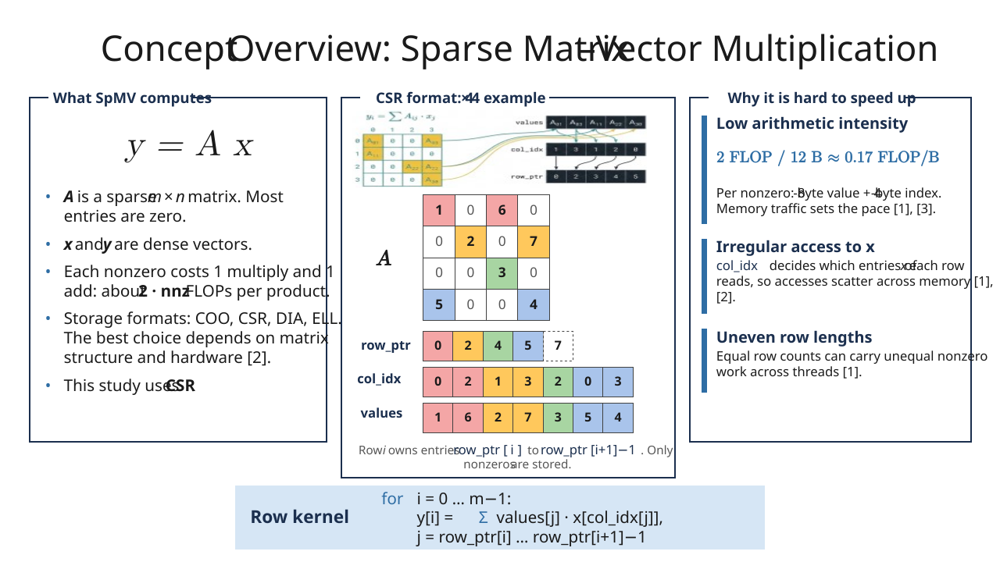

# Parallel SpMV in OpenMP & CUDA

A performance-focused C++ project for studying CSR-based sparse matrix–vector multiplication (SpMV) across serial, OpenMP, and CUDA implementations.

This repository is designed around a practical research question: how does workload structure, memory access pattern, and host/device data movement affect the performance of SpMV on modern parallel hardware?

## Project summary

SpMV solves the linear-algebra operation

```text
y = A · x
```

where `A` is a sparse matrix and `x` is a dense vector. In sparse formats such as CSR (compressed sparse row), the matrix is stored by values, column indices, and row pointers instead of storing all zeros explicitly. This is ideal for large sparse problems, but it creates a memory-bound workload where performance is dominated more by bandwidth and irregular memory access than by arithmetic throughput.


This repository implements and benchmarks:

- Serial CSR SpMV baseline
- OpenMP-parallel CSR SpMV
- CUDA CSR kernels, including a shared-memory optimization
- Validation and benchmarking pipelines
- Plotting scripts for comparing performance trends

## Why this project matters

Sparse matrix multiplication is fundamental in:

- scientific computing
- graph analytics
- iterative solvers
- machine learning and optimization
- finite element and PDE workloads

The key challenge is that sparse kernels often have low arithmetic intensity: each nonzero may require a multiply and add, but the data movement can dominate the runtime. That makes workload balance and memory behavior critical for performance.

## Research focus

The work is organized around four research questions:

1. Scaling: how does OpenMP SpMV behave as thread count changes?
2. Load balance: when does static row scheduling become inefficient?
3. Memory behavior: how do irregular accesses and matrix sparsity constrain speed?
4. GPU data movement: how do transfer and allocation costs affect CUDA speedup?

## Repository structure

```text
.
├── src/
│   ├── SparseMatrix.h, SparseMatrix.cpp       # CSR matrix representation
│   ├── serial/                                 # Serial SpMV baseline
│   ├── openmp/                                 # OpenMP SpMV implementation
│   ├── cuda/                                   # CUDA scalar and shared-memory kernels
│   ├── testing/                                # Validation and benchmarking executables
│   └── plotting/                               # Plotting scripts for results
├── docs/
│   └── CUDA_GUIDE.md                           # CUDA build/run instructions
├── Makefile                                    # CPU build system
├── Makefile.cuda                               # CUDA build system
├── benchmark_results.csv                       # Recorded 2-thread pilot results
├── README.md                                   # Project overview
└── Sparse-Matrix-Vector-Multiplication/        # Output/packaged artifacts
```

## Project status

| Tag | Kernel | Status |
|-----|--------|--------|
| S0 | Serial CSR row loop | Implemented and benchmarked |
| O0 | OpenMP static row-parallel loop | Implemented and benchmarked |
| G0 | CUDA scalar kernel | Implemented and correctness-validated |
| G1 | CUDA shared-memory kernel | Implemented and automatically selected by size |
| — | Nonzero-aware row partitioning | Designed, not yet benchmarked |

## Quick start

### Requirements

- GCC 7+ with C++17 and OpenMP support
- Python 3 with `matplotlib` and `pandas` for plotting
- Optional: CUDA Toolkit for GPU builds

### Build and run the CPU version

```bash
make all
make test
make bench
make plot
```

Or run the full workflow in one step:

```bash
make run
```

### Build and run the CUDA version

```bash
make -f Makefile.cuda all
make -f Makefile.cuda test
make -f Makefile.cuda bench
```

See [docs/CUDA_GUIDE.md](docs/CUDA_GUIDE.md) for GPU setup details and CUDA-specific guidance.

## Common commands

```bash
# Build all CPU targets
make all

# Validate correctness
make test

# Run benchmark suite
make bench

# Generate plots
make plot

# Full workflow: build + validate + benchmark + plot
make run

# Clean build artifacts
make clean
```

For OpenMP thread count:

```bash
export OMP_NUM_THREADS=8
make bench
```

## Validation

Each implementation is checked against a dense-matrix ground truth. The project tracks

```text
ε_max = max_i |y_impl - y_truth|
```

and the recorded validation runs satisfy `ε_max < 1e-10` for tested cases. The row-wise parallel design remains race-free because each thread owns a distinct output element.

## Performance snapshot

The current benchmark file includes a two-thread CPU pilot over random square matrices at roughly 10% density.

| n | nnz | Serial (ms) | OpenMP (ms) | Speedup |
|---:|---:|---:|---:|---:|
| 100 | 1,002 | 0.001458 | 0.001726 | 0.845× |
| 200 | 3,957 | 0.005164 | 0.004930 | 1.047× |
| 500 | 25,008 | 0.031886 | 0.026172 | 1.218× |
| 1,000 | 100,084 | 0.118434 | 0.113091 | 1.047× |
| 2,000 | 400,247 | 0.550202 | 0.420618 | 1.308× |
| 5,000 | 2,498,138 | 3.477790 | 2.436810 | 1.427× |
| 10,000 | 9,999,375 | 14.258790 | 10.178649 | 1.401× |

Key takeaways:

- Small matrices can be slower with OpenMP because of thread overhead.
- The gain becomes clear as matrix size grows.
- The behavior is consistent with a memory-bound kernel that is limited by bandwidth rather than floating-point compute.

## Experimental roadmap

The repo is already structured for deeper study, and the next step is to close the full research loop:

- Strong and weak scaling studies across thread counts
- Load-balance comparisons for regular and skewed matrices
- CUDA end-to-end timing vs. kernel-only timing
- Larger and more realistic sparse matrices from real workloads

## References

1. Bell, N., and Garland, M. "Implementing sparse matrix-vector multiplication on throughput-oriented processors." SC '09.
2. Filippone, S., et al. "Sparse matrix-vector multiplication on GPGPUs." ACM Transactions on Mathematical Software, 2017.
3. Williams, S., et al. "Optimization of sparse matrix-vector multiplication on emerging multicore platforms." Parallel Computing, 2009.
4. Liu, Y., and Schmidt, B. "LightSpMV: Faster CUDA-compatible sparse matrix-vector multiplication using compressed sparse rows." Journal of Signal Processing Systems, 2018.
5. He, G., and Gao, J. "A novel CSR-based sparse matrix-vector multiplication on GPUs." Mathematical Problems in Engineering, 2016.
6. Buluç, A., et al. "Parallel sparse matrix-vector and matrix-transpose-vector multiplication using compressed sparse blocks." SPAA '09.
7. Giannoula, C., et al. "SparseP: Towards efficient sparse matrix vector multiplication on real processing-in-memory architectures." PACM on Measurement and Analysis of Computing Systems, 2022.

## Author and course context

- Author: Ahmed Shmels Muhe (22617089)
- Course: Parallel Computing (3090440020)
- Instructor: Prof. He Guo
- Department: Software Technology, Dalian University of Technology
